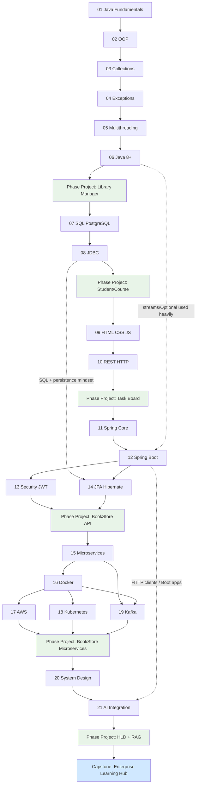
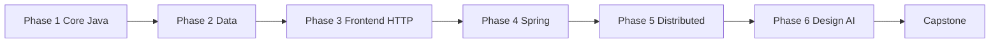

# Dependency Map — Topics 01–21

What each topic needs before it, and why this roadmap stays **strictly serial** at 1 hour/day.

---

## Recommendation

Some topics *could* theoretically overlap (e.g. Frontend while finishing JDBC). **Do not parallelize** on a 1 hr/day cadence:

- Context switching burns the hour
- Phase projects assume prior topics are solid
- Gates exist to prevent fragile “half knowledge”

Use this map to understand *why* order matters — not to invent a parallel track.

---

## Flowchart (learning order)

Solid arrows = required learning order. Dotted arrows = concepts reused later (already covered if you stay serial).

---

## Prerequisite table

| Topic | Hard prerequisites | Soft / helpful | Theoretically parallel with? | Serial recommendation |
|-------|-------------------|----------------|------------------------------|------------------------|
| **01 Fundamentals** | None (tools setup) | Basic computer literacy | — | First |
| **02 OOP** | 01 | — | — | After 01 |
| **03 Collections** | 02 | — | — | After 02 |
| **04 Exceptions** | 02 (ideally 03) | 03 for richer examples | Light overlap with late 03 | After 03 |
| **05 Multithreading** | 02–04 | Collections | — | After 04 |
| **06 Java 8+** | 03–04 | 05 for concurrent streams caution | — | After 05 |
| **07 SQL & PostgreSQL** | Phase 1 done | — | *Could* start after 02 conceptually | After Phase 1 project |
| **08 JDBC** | 01–04, 07 | 06 | — | After 07 |
| **09 HTML/CSS/JS** | Phase 2 recommended | — | *Could* after Phase 1 | After Phase 2 |
| **10 REST & HTTP** | 09 for consuming APIs; JSON literacy | 08 for “backend mindset” | — | After 09 |
| **11 Spring Core** | 02, 06 | Phase 2–3 | — | After Phase 3 |
| **12 Spring Boot** | 11, 10 | 08 | — | After 11 |
| **13 Security & JWT** | 12, 10 | — | *Could* interleave late with 14 | After 12; before or tightly with 14 |
| **14 JPA & Hibernate** | 12, 07–08 | 06 | *Could* interleave with 13 | After 12; complete with 13 before phase project |
| **15 Microservices** | 12–14, 10 | — | — | After Phase 4 |
| **16 Docker** | 12 (app to containerize) | 15 | *Could* learn basics earlier | After 15 (or late 15) |
| **17 AWS** | 16 strongly | 15 | After Docker basics | After 16 |
| **18 Kubernetes** | 16 | 15, 17 | After Docker | After 16; preferably after tasting AWS |
| **19 Kafka** | 15, Java concurrency awareness (05) | 16 for local brokers | *Could* with late 16–18 | After 15–16 |
| **20 System Design** | Phases 1–5 experience | — | Reading earlier is OK; deep work last | After Phase 5 |
| **21 AI Integration** | 12, HTTP clients, JSON | 20 for architecture | — | After 20 |
| **Capstone** | 01–21 + all phase projects | — | — | Last |

---

## Parallelization notes (theoretical only)

| Pair / group | Why it *could* parallelize | Why you still shouldn’t (1 hr/day) |
|--------------|----------------------------|-------------------------------------|
| 09 Frontend ∥ late Phase 2 | Different skill domain | Two unfinished stacks; Task Board needs REST clarity |
| 13 Security ∥ 14 JPA | Both hang off Boot | BookStore needs both integrated; learn sequentially then merge in project week |
| 17 AWS ∥ 18 K8s | Both are “ops” | Shared Docker base; thrashing YAML/cloud consoles wastes hours |
| 19 Kafka ∥ 17/18 | Event bus vs deploy | Phase project needs a working event path *and* containers |
| 20 Design early reading | Concepts help earlier projects | Without build scars, design stays abstract |

**Allowed exception:** Light *reading* of a future topic’s overview on Day 7 review — no exercises that diverge from the current topic.

---

## Phase dependency summary

| From → To | Blocking reason |
|-----------|-----------------|
| 1 → 2 | JDBC needs solid Java + exceptions |
| 2 → 3 | UI/API work assumes you can think in persisted resources |
| 3 → 4 | Boot controllers assume HTTP/REST fluency |
| 4 → 5 | Microservices need a working monolith/API to split |
| 5 → 6 | Design and AI integrate patterns you have already built |
| 6 → Capstone | Capstone composes everything under one product vision |

---

## Related docs

- [learning-path.md](./learning-path.md)  
- [timeline-estimates.md](./timeline-estimates.md)  
- [weekly-milestones.md](./weekly-milestones.md)  
