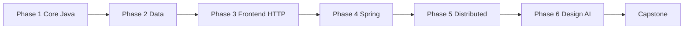

# Learning Path — Java Full Stack Mastery

Ordered path from zero to an enterprise-style full-stack project. **Learning and building only** — no interview, placement, resume, or job content.

**Cadence:** 1 hour/day · strict serial order · advance only through phase gates.

---

## How to use this path

1. Complete topics **01 → 21** in order. Do not skip ahead.
2. Each topic has a file under `../phase-*/` with concepts, exercises, and a mastery checklist.
3. Finish the **phase project** before starting the next phase.
4. Pass the **phase gate** (≥90% checklist + phase project running end-to-end).
5. Log weekly progress in [progress-tracker.md](./progress-tracker.md).

**Done for a topic** means: you can explain the core ideas in your own words, complete the exercises without copying, and check ≥90% of that topic’s mastery checklist.

**Done for a phase** means: every topic in the phase meets “done,” **and** the phase project runs from a clean checkout with documented steps.

---

## Optimization notes (strict serial)

| Rule | Why |
|------|-----|
| One topic at a time | 1 hr/day leaves no room for context switching |
| Phase project before next phase | Locks skills with a real build, not isolated drills |
| Prefer official docs | Less noise; fewer conflicting mental models |
| Stuck >30 min → smaller slice tomorrow | Protects the daily habit |
| Do not parallelize “because they feel independent” | Theoretical overlaps exist (see [dependency-map.md](./dependency-map.md)); still stay serial |

Optional later (only after Capstone): revisit weak topics for depth. During the path, go forward.

---

## Phase 1 — Core Java (~18–20 weeks)

**Goal:** Write solid, idiomatic console/layered Java without frameworks.

| Step | Topic | File | What “done” looks like |
|------|--------|------|------------------------|
| 01 | Java Fundamentals | [../phase-01-core-java/01-java-fundamentals.md](../phase-01-core-java/01-java-fundamentals.md) | JDK 21 installed; variables, control flow, methods, arrays, I/O; small CLI programs compile and run |
| 02 | OOP Concepts | [../phase-01-core-java/02-oops.md](../phase-01-core-java/02-oops.md) | Classes, inheritance, interfaces, encapsulation, polymorphism used deliberately in small designs |
| 03 | Collections Framework | [../phase-01-core-java/03-collections.md](../phase-01-core-java/03-collections.md) | Choose List/Set/Map correctly; iterate, sort, search; understand big-O at a practical level |
| 04 | Exception Handling | [../phase-01-core-java/04-exception-handling.md](../phase-01-core-java/04-exception-handling.md) | Checked vs unchecked; try/catch/finally; custom exceptions; fail clearly, not silently |
| 05 | Multithreading | [../phase-01-core-java/05-multithreading.md](../phase-01-core-java/05-multithreading.md) | Threads, Runnable, ExecutorService, basic sync (`synchronized`, volatile awareness); no race in demos |
| 06 | Java 8+ Features | [../phase-01-core-java/06-java8-plus.md](../phase-01-core-java/06-java8-plus.md) | Lambdas, Streams, Optional, `java.time`, records/sealed where useful |

**Phase project:** [Library Manager](../phase-01-core-java/phase-project.md) — console app with layered packages (domain / service / repository-in-memory), OOP + collections + exceptions + optional concurrent report job.

### Phase 1 gate

Advance to Phase 2 only when **all** are true:

- [ ] Topics 01–06 mastery checklists each ≥90%
- [ ] Library Manager runs end-to-end (add/list/search/borrow-return or equivalent flows)
- [ ] You can explain package layout and why each layer exists
- [ ] Notes cover pitfalls you hit (nulls, mutability, exception design)

---

## Phase 2 — Data (~5–6 weeks)

**Goal:** Model data in SQL and access it from Java with JDBC.

| Step | Topic | File | What “done” looks like |
|------|--------|------|------------------------|
| 07 | SQL & PostgreSQL | [../phase-02-data/07-sql-postgresql.md](../phase-02-data/07-sql-postgresql.md) | DDL/DML, joins, indexes basics, constraints; write queries against a local Postgres DB |
| 08 | JDBC | [../phase-02-data/08-jdbc.md](../phase-02-data/08-jdbc.md) | Connections, prepared statements, transactions, DAO pattern; no SQL string concat for user input |

**Phase project:** [Student/Course](../phase-02-data/phase-project.md) — Postgres schema + JDBC CRUD + simple reports (enrollments, course lists).

### Phase 2 gate

- [ ] Topics 07–08 checklists ≥90%
- [ ] Student/Course project: schema migrates (or SQL scripts run), CRUD works, at least one multi-table query
- [ ] Transactions demonstrated (commit/rollback path)
- [ ] Credentials not hard-coded in committed source (env or local config ignored by Git)

---

## Phase 3 — Frontend & HTTP (~6–7 weeks)

**Goal:** Build a usable UI and speak HTTP/REST fluently before Spring.

| Step | Topic | File | What “done” looks like |
|------|--------|------|------------------------|
| 09 | HTML, CSS, JavaScript | [../phase-03-frontend-api/09-html-css-js.md](../phase-03-frontend-api/09-html-css-js.md) | Semantic HTML, responsive layout, DOM events, `fetch` to a local API or mock |
| 10 | REST API & HTTP | [../phase-03-frontend-api/10-rest-http.md](../phase-03-frontend-api/10-rest-http.md) | Methods, status codes, headers, JSON bodies; design a small resource API; test in Postman |

**Phase project:** [Task Board](../phase-03-frontend-api/phase-project.md) — HTML/CSS/JS board + documented REST contract + Postman collection (mock server or thin Java HTTP stub is fine).

### Phase 3 gate

- [ ] Topics 09–10 checklists ≥90%
- [ ] Task Board UI loads and performs create/update/list against the contract
- [ ] Postman collection covers happy path + at least one error case (4xx)
- [ ] You can sketch request/response for each endpoint without looking up notes

---

## Phase 4 — Spring Stack (~12–14 weeks)

**Goal:** Build a secured Spring Boot API with persistence.

| Step | Topic | File | What “done” looks like |
|------|--------|------|------------------------|
| 11 | Spring Core | [../phase-04-spring/11-spring-core.md](../phase-04-spring/11-spring-core.md) | IoC/DI, beans, scopes, configuration vs annotations; wire a small non-Boot app |
| 12 | Spring Boot | [../phase-04-spring/12-spring-boot.md](../phase-04-spring/12-spring-boot.md) | Starters, `application.yml`, controllers, validation, actuator basics, profiles |
| 13 | Spring Security & JWT | [../phase-04-spring/13-spring-security-jwt.md](../phase-04-spring/13-spring-security-jwt.md) | AuthN/AuthZ, JWT filter chain, roles, protected vs public routes |
| 14 | JPA & Hibernate | [../phase-04-spring/14-jpa-hibernate.md](../phase-04-spring/14-jpa-hibernate.md) | Entities, repositories, relationships, lazy vs eager awareness, transactions |

**Phase project:** [BookStore API](../phase-04-spring/phase-project.md) — Boot + JPA + JWT + Postgres; books/orders (or equivalent) with auth.

### Phase 4 gate

- [ ] Topics 11–14 checklists ≥90%
- [ ] BookStore API: register/login, JWT on protected routes, CRUD + at least one relationship query
- [ ] Validation and meaningful error responses
- [ ] App starts with documented env vars; Flyway/Liquibase or SQL init works

---

## Phase 5 — Distributed Systems (~16–18 weeks)

**Goal:** Split services, containerize, deploy basics, stream events.

| Step | Topic | File | What “done” looks like |
|------|--------|------|------------------------|
| 15 | Microservices | [../phase-05-distributed/15-microservices.md](../phase-05-distributed/15-microservices.md) | Service boundaries, sync vs async, API gateway idea, resilience basics |
| 16 | Docker | [../phase-05-distributed/16-docker.md](../phase-05-distributed/16-docker.md) | Images, containers, Dockerfile, Compose for app + Postgres |
| 17 | AWS Cloud | [../phase-05-distributed/17-aws.md](../phase-05-distributed/17-aws.md) | Core services for a Java app (e.g. EC2/ECS or Elastic Beanstalk, RDS, S3, IAM basics) — hands-on free-tier style labs |
| 18 | Kubernetes | [../phase-05-distributed/18-kubernetes.md](../phase-05-distributed/18-kubernetes.md) | Pods, Deployments, Services, ConfigMaps/Secrets; local cluster (minikube/kind) deploys your app |
| 19 | Kafka | [../phase-05-distributed/19-kafka.md](../phase-05-distributed/19-kafka.md) | Topics, producers/consumers, at-least-once awareness; Java client or Spring Kafka demo |

**Phase project:** [BookStore Microservices](../phase-05-distributed/phase-project.md) — split BookStore (e.g. catalog + orders), Docker Compose, Kafka event on order placed.

### Phase 5 gate

- [ ] Topics 15–19 checklists ≥90%
- [ ] At least two services communicate; one async path via Kafka
- [ ] `docker compose up` (or documented equivalent) brings stack up
- [ ] One K8s deploy path works locally for a service
- [ ] Short architecture note: why split, how data flows

---

## Phase 6 — Architecture & AI (~7–8 weeks)

**Goal:** Design systems deliberately; integrate AI features into Java apps.

| Step | Topic | File | What “done” looks like |
|------|--------|------|------------------------|
| 20 | System Design | [../phase-06-architecture-ai/20-system-design.md](../phase-06-architecture-ai/20-system-design.md) | Requirements → HLD/LLD; caching, queues, DB choices, consistency trade-offs for systems you can build |
| 21 | AI Integration with Java | [../phase-06-architecture-ai/21-ai-integration.md](../phase-06-architecture-ai/21-ai-integration.md) | Call an LLM/embedding API from Java; simple RAG or Q&A over your docs; safe prompts and timeouts |

**Phase project:** [HLD/LLD + RAG Q&A](../phase-06-architecture-ai/phase-project.md) — design doc for Learning Hub + working Java RAG/Q&A slice.

### Phase 6 gate

- [ ] Topics 20–21 checklists ≥90%
- [ ] Written HLD + key LLD components for the capstone vision
- [ ] RAG/Q&A demo answers questions from a small document set
- [ ] Failure modes noted (API down, empty retrieval, rate limits)

---

## Capstone — Enterprise Learning Hub (~8–10 weeks)

| Project | File | What “done” looks like |
|---------|------|------------------------|
| Enterprise Learning Hub | [../capstone/enterprise-platform.md](../capstone/enterprise-platform.md) | End-to-end product: auth, courses/content, APIs, UI, persistence, containers; optional Kafka/AI features from prior phases |

### Capstone gate (journey complete)

- [ ] Documented architecture matches what runs
- [ ] Happy-path user journeys work (sign up → browse/learn → progress or equivalent)
- [ ] Compose (and optionally K8s) deploy documented
- [ ] README: setup, env, how to demo, known limits
- [ ] You can walk through the system layer by layer without notes

---

## Path spine (quick view)

```text
01–06 Core Java → Library Manager
07–08 Data → Student/Course (JDBC + Postgres)
09–10 Frontend + REST → Task Board
11–14 Spring → BookStore API
15–19 Distributed → BookStore Microservices
20–21 Design + AI → HLD/LLD + RAG
Capstone → Enterprise Learning Hub
```



---

## Related docs

| Doc | Use when |
|-----|----------|
| [daily-schedule.md](./daily-schedule.md) | Structuring each hour and week |
| [dependency-map.md](./dependency-map.md) | Why order is fixed |
| [timeline-estimates.md](./timeline-estimates.md) | Planning weeks/hours |
| [weekly-milestones.md](./weekly-milestones.md) | Concrete week checkpoints |
| [progress-tracker.md](./progress-tracker.md) | Logging reality vs plan |
| [mastery-checklist-all.md](./mastery-checklist-all.md) | Aggregate checkboxes |
