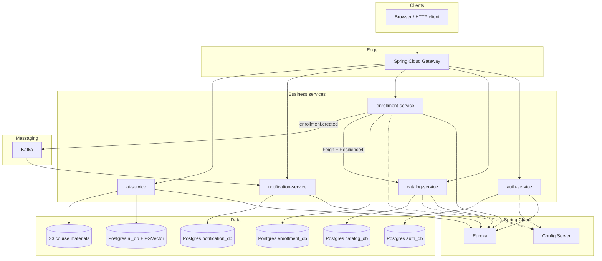
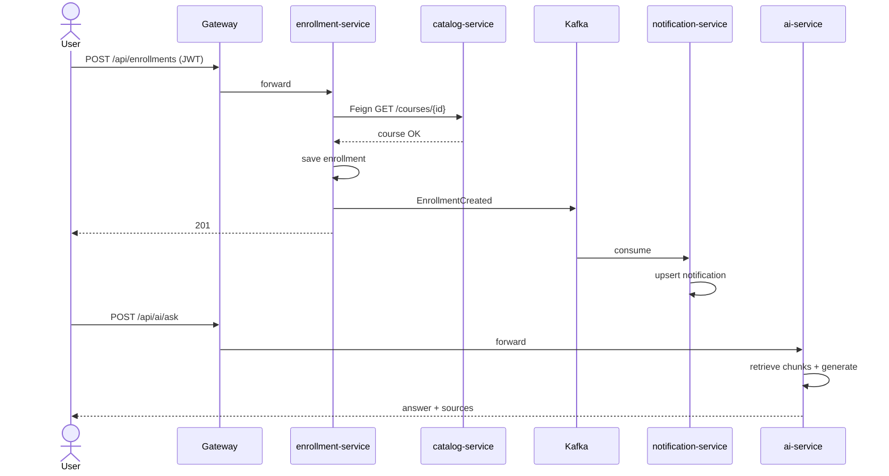

# Capstone — Enterprise Learning Hub

**Duration:** ~8–10 weeks (56–70 days) · **Cadence:** 1 hour/day  
**Outcome:** An end-to-end learning platform: Spring Boot microservices (Auth, Catalog, Enrollment, Notification), JWT via Gateway, per-service PostgreSQL, Eureka/Config/Gateway + Feign + Resilience4j, Docker Compose, AWS learning deploy path, Kubernetes manifests, Kafka events, and AI chatbot + document Q&A over course materials

---

## 1. Why this topic is important

The Capstone is where the entire roadmap becomes one product. Isolated phases taught Java, SQL, REST, Spring, security, microservices, containers, messaging, design, and AI. Enterprise Learning Hub forces those skills to **cooperate**: a learner signs up, browses courses, enrolls, gets notified, and asks an assistant questions grounded in course documents.

Finishing it proves you can own a system—architecture, code, local compose, a cloud path, and a honest demo with known limits—not just complete tutorials. Everything stays learning-focused: build, run, explain, improve.

---

## 2. Prerequisites

- Phase gates 1–6 complete (topics + phase projects)
- Phase 6 design pack + RAG slice available to reuse ([../phase-06-architecture-ai/phase-project.md](../phase-06-architecture-ai/phase-project.md))
- Comfortable with: Spring Boot 3, JPA, JWT, Gateway, Feign, Resilience4j, Kafka, Docker Compose, basic Kubernetes
- Accounts/tools for learning deploys: Docker Desktop (or Engine), optional AWS free-tier style account, optional local Kubernetes (kind/minikube/k3d)
- LLM API access for AI features (env-based keys)

**Suggested stack**

| Piece | Choice |
|-------|--------|
| Services | Spring Boot 3.x · JDK 17+ |
| Discovery / Config / Edge | Eureka · Spring Cloud Config · Spring Cloud Gateway |
| Clients / resilience | OpenFeign · Resilience4j |
| Security | Spring Security + JWT validated at Gateway (and/or services) |
| Data | PostgreSQL per service (separate DBs or logical DBs); JPA |
| Messaging | Apache Kafka |
| AI | LangChain4j **or** Spring AI — chatbot + RAG Q&A |
| Containers | Dockerfile per service · Docker Compose for local |
| Cloud learning path | AWS EC2 + RDS + S3 |
| Orchestration | Kubernetes Deployments, Services, ConfigMaps/Secrets, Ingress |
| Build | Maven or Gradle multi-module optional |

---

## 3. Concepts to learn (beginner → intermediate → advanced)

Capstone is mostly **integration**. New learning is product assembly and operational paths.

### Beginner (Platform v1 — vertical slice)

| Focus | Apply |
|-------|--------|
| Repo layout | Multi-module or multi-repo folders with clear service boundaries |
| Auth service | Register/login JWT |
| Catalog service | Courses CRUD/list |
| Gateway | Route `/api/auth/**`, `/api/catalog/**` |
| Compose | Postgres × N + services up together |

### Intermediate (Platform v2 — enrollment, events, AI)

| Focus | Apply |
|-------|--------|
| Enrollment service | Enroll user in course; own DB |
| Kafka | `enrollment.created` → Notification consumer |
| Notification | Persist in-app notification; email stub/log |
| Feign + Resilience4j | Enrollment → Catalog course validation with circuit breaker |
| AI service | Chatbot + RAG over materials in S3 or local volume |
| Config / Eureka | Services discover each other in Compose |

### Advanced (Platform v3 — K8s, AWS path, harden)

| Focus | Apply |
|-------|--------|
| K8s | Deployments, Services, ConfigMaps/Secrets, Ingress |
| AWS path | EC2 hosts Compose or single-node; RDS for Postgres; S3 for materials |
| Observability | Actuator probes; structured logs; correlation id notes |
| Hardening | Idempotent consumers, timeouts, README demo script |
| Mastery | Walk architecture without notes |

---

## 4. Daily learning tasks (numbered day blocks)

**How to use:** Open the **Learn** links (10 min) → follow every numbered **Practice** step (35–40 min) → tick boxes when done.

**Daily template (60 min):** 10 min Learn · 40 min Practice steps · 10 min notes · mark boxes

*10-week plan below; 8-week compression notes at end of §11.*

### Week 1 — Skeleton, Auth, Gateway (Days 1–7)

- [ ] **Day 1 — Monorepo skeleton**
  - [ ] **Learn:** §6 repo layout in this file · [Spring Boot reference](https://docs.spring.io/spring-boot/reference/)
  - [ ] **Practice:** Create monorepo layout and root docs
    1. Create root folder `enterprise-learning-hub/` (or rename if you already started).
    2. Create folders exactly: `platform/eureka-server/`, `platform/config-server/`, `platform/gateway/`, `services/auth-service/`, `services/catalog-service/`, `services/enrollment-service/`, `services/notification-service/`, `services/ai-service/`, `infra/k8s/`, `infra/aws/`, `docs/`, `scripts/`, `materials/`.
    3. Add root `README.md` with: project name, one-paragraph goal, “stack at a glance,” and placeholders for Local / AWS / K8s.
    4. Add `.env.example` with empty keys: `JWT_SECRET=`, `POSTGRES_USER=`, `POSTGRES_PASSWORD=`, `OPENAI_API_KEY=` (or your LLM key), `AWS_REGION=`.
    5. Add `.gitignore` ignoring `.env`, `**/target/`, `.idea/`, `*.iml`.
    6. **Done when:** Tree matches §6 layout and `README.md` + `.env.example` exist at root.

- [ ] **Day 2 — Auth service + DB**
  - [ ] **Learn:** [Spring Data JPA](https://docs.spring.io/spring-data/jpa/reference/) · [PostgreSQL docs](https://www.postgresql.org/docs/current/)
  - [ ] **Practice:** Boot `auth-service` against `auth_db`
    1. In `services/auth-service/`, generate a Spring Boot 3.x app (Web, Data JPA, PostgreSQL, Validation).
    2. In Compose (or local Postgres), create database `auth_db` (user/password from `.env`).
    3. Entity `User`: `id`, `email` (unique), `passwordHash`, `role` (`USER`/`ADMIN`), `createdAt`.
    4. Repository + Flyway/Liquibase **or** `ddl-auto=update` for learning; prefer a migration file if you already know Flyway.
    5. `GET /actuator/health` on auth port (e.g. `8081`) returns `UP` when DB is reachable.
    6. **Done when:** App starts, connects to `auth_db`, and health is `UP`.

- [ ] **Day 3 — Register/login JWT**
  - [ ] **Learn:** [Spring Security](https://docs.spring.io/spring-security/reference/)
  - [ ] **Practice:** Register/login JWT with BCrypt
    1. Add Spring Security + JWT library (jjwt or Nimbus); read `JWT_SECRET` from env.
    2. `POST /api/auth/register` body `{ "email", "password" }` → BCrypt-hash password, save user, return `201` (or `200` + token — pick one and stick to it).
    3. `POST /api/auth/login` → validate credentials → return `{ "accessToken", "tokenType": "Bearer" }` with claims `sub`=userId, `email`, `role`.
    4. Curl register: expect `201`/`200`. Curl login: expect `200` + JWT. Curl login with bad password: expect `401`.
    5. Confirm DB stores **hash**, never plaintext password.
    6. **Done when:** Register + login curls succeed and password column is BCrypt.

- [ ] **Day 4 — Eureka + Config**
  - [ ] **Learn:** [Spring Cloud Netflix Eureka](https://docs.spring.io/spring-cloud-netflix/reference/html/) · [Spring Cloud Config](https://docs.spring.io/spring-cloud-config/reference/)
  - [ ] **Practice:** Minimal Eureka + Config; auth registers
    1. Create `platform/eureka-server/` Boot app with `@EnableEurekaServer` (port `8761`).
    2. Create `platform/config-server/` with `@EnableConfigServer` pointing at a local `config-repo/` or classpath configs (port `8888`).
    3. Add Eureka client to `auth-service`; set `spring.application.name=auth-service`.
    4. Start eureka → config (optional for auth today) → auth; open `http://localhost:8761` and confirm `AUTH-SERVICE` is UP.
    5. Note in `docs/architecture.md`: discovery ports and names.
    6. **Done when:** Eureka dashboard lists `auth-service` as UP.

- [ ] **Day 5 — Gateway to auth**
  - [ ] **Learn:** [Spring Cloud Gateway](https://docs.spring.io/spring-cloud-gateway/reference/)
  - [ ] **Practice:** Route auth through Gateway and issue JWT via it
    1. Create `platform/gateway/` (Spring Cloud Gateway + Eureka discovery client), port `8080`.
    2. Route: `Path=/api/auth/**` → `lb://auth-service` (or `http://auth-service:8081` if not using lb yet).
    3. Start eureka + auth + gateway. Curl **through Gateway**: `POST http://localhost:8080/api/auth/register` and `/api/auth/login`.
    4. Expect `200`/`201` with JWT from login via Gateway (not direct auth port).
    5. Confirm direct auth still works on its own port for debugging.
    6. **Done when:** Login via `localhost:8080` returns a Bearer JWT.

- [ ] **Day 6 — Compose edge stack**
  - [ ] **Learn:** [Dockerfile](https://docs.docker.com/reference/dockerfile/) · [Docker Compose](https://docs.docker.com/compose/)
  - [ ] **Practice:** Dockerfiles + Compose for Postgres, eureka, auth, gateway
    1. Add `Dockerfile` under `services/auth-service/` and `platform/gateway/` (multi-stage: build jar → `eclipse-temurin` runtime).
    2. Add/extend root `docker-compose.yml` services: `postgres-auth` (DB `auth_db`), `eureka`, `gateway`, `auth-service` (and stub `config` if ready).
    3. Wire env: JDBC URL `jdbc:postgresql://postgres-auth:5432/auth_db`, Eureka `http://eureka:8761/eureka`.
    4. Run `docker compose up -d --build postgres-auth eureka auth-service gateway` (adjust names to yours).
    5. `docker compose ps` shows healthy/running; Gateway port `8080` published.
    6. **Done when:** Compose brings up edge stack and Gateway responds on `8080`.

- [ ] **Day 7 — Curl through Gateway**
  - [ ] **Learn:** [Gateway](https://docs.spring.io/spring-cloud-gateway/reference/) · [Actuator](https://docs.spring.io/spring-boot/reference/actuator/endpoints.html)
  - [ ] **Practice:** Documented register/login curls; CORS if needed
    1. From host: `curl -i -X POST http://localhost:8080/api/auth/register -H "Content-Type: application/json" -d "{\"email\":\"u1@example.com\",\"password\":\"Secret123!\"}"` → expect `201` or `200`.
    2. Login same user → expect `200` and copy `accessToken`.
    3. Optional: `curl -i http://localhost:8080/actuator/health` (or gateway health) → `200`/`UP`.
    4. If a future UI on another origin: add Gateway/CORS allowlist for `localhost:5173` (or your UI port); verify preflight `OPTIONS` returns `204`/`200`.
    5. Paste exact curls into README “Quick start.”
    6. **Done when:** README curls work against Compose Gateway and JWT is obtained.

### Week 2 — Catalog service (Days 8–14)

- [ ] **Day 8 — Catalog + Course entity**
  - [ ] **Learn:** [Spring Data JPA](https://docs.spring.io/spring-data/jpa/reference/)
  - [ ] **Practice:** Stand up `catalog-service` + `catalog_db`
    1. Create `services/catalog-service/` Boot app (Web, JPA, PostgreSQL, Eureka client).
    2. Add Compose service `postgres-catalog` with database `catalog_db`; JDBC from catalog-service.
    3. Entity `Course`: `id`, `code` (unique), `title`, `description`, `active`, timestamps.
    4. Register with Eureka as `catalog-service`; confirm on dashboard.
    5. `GET /actuator/health` on catalog port → `UP`.
    6. **Done when:** Catalog starts against `catalog_db` and appears in Eureka.

- [ ] **Day 9 — Course CRUD**
  - [ ] **Learn:** [Spring Web / REST](https://docs.spring.io/spring-boot/reference/web/servlet.html) · [Spring Security](https://docs.spring.io/spring-security/reference/)
  - [ ] **Practice:** Admin CRUD + list/get endpoints
    1. `POST /api/catalog/courses` (admin) create; `PUT`/`PATCH` update; `DELETE` soft-delete or hard-delete (document choice).
    2. `GET /api/catalog/courses` list; `GET /api/catalog/courses/{id}` detail.
    3. For now protect mutating endpoints with a simple role check or temporary basic auth; list may be authenticated-only.
    4. Curl create → `201`; get by id → `200`; missing id → `404`.
    5. Validate `@NotBlank` on `title`/`code`; bad body → `400`.
    6. **Done when:** Create/list/get curls return expected status codes.

- [ ] **Day 10 — JWT on catalog**
  - [ ] **Learn:** [Spring Security](https://docs.spring.io/spring-security/reference/) · [Gateway](https://docs.spring.io/spring-cloud-gateway/reference/)
  - [ ] **Practice:** Choose and implement JWT trust model
    1. Decide: (A) catalog validates JWT with shared `JWT_SECRET`, or (B) Gateway validates and forwards `X-User-Id` / `X-User-Role` (document in `docs/architecture.md`).
    2. Implement the chosen model; reject anonymous mutating calls with `401`.
    3. Curl list **without** token → `401` (if you require auth) or `200` if public list — document which.
    4. Curl with Bearer from auth login → `200`.
    5. Admin-only create: user role → `403`; admin → `201`.
    6. **Done when:** Notes state the trust model and status codes match it.

- [ ] **Day 11 — Catalog routes**
  - [ ] **Learn:** [Spring Cloud Gateway](https://docs.spring.io/spring-cloud-gateway/reference/) · [OpenFeign](https://docs.spring.io/spring-cloud-openfeign/reference/)
  - [ ] **Practice:** Gateway `/api/catalog/**` + Feign-ready packages
    1. Add Gateway route `Path=/api/catalog/**` → `lb://catalog-service`.
    2. Curl `GET http://localhost:8080/api/catalog/courses` with Bearer → `200`.
    3. In `enrollment-service` (stub OK), create package `client/` for future Feign `CatalogClient`.
    4. Align path prefixes so Gateway strip/prefix matches controller mappings (no double `/api`).
    5. Update README with catalog Gateway curl.
    6. **Done when:** Catalog is reachable only via Gateway path in the happy-path docs.

- [ ] **Day 12 — Seed & pagination**
  - [ ] **Learn:** [Spring Data JPA pagination](https://docs.spring.io/spring-data/jpa/reference/)
  - [ ] **Practice:** Seed courses and paginate list
    1. Add `scripts/seed/courses.json` or `ApplicationRunner` seeding ≥5 courses (distinct `code`s).
    2. List endpoint accepts `page`, `size` (default `page=0&size=10`); return Spring `Page` JSON or `{ content, totalElements }`.
    3. Curl `?page=0&size=2` → exactly 2 items when ≥2 exist; `totalElements` ≥5.
    4. Idempotent seed: re-run does not duplicate by `code`.
    5. Commit seed data under `scripts/seed/`.
    6. **Done when:** Paginated Gateway list shows seeded courses without duplicates.

- [ ] **Day 13 — Compose + catalog E2E**
  - [ ] **Learn:** [Docker Compose](https://docs.docker.com/compose/)
  - [ ] **Practice:** Full edge + catalog Compose E2E
    1. Add `catalog-service` + `postgres-catalog` to `docker-compose.yml`; Dockerfile for catalog.
    2. `docker compose up -d --build` for postgres-auth, postgres-catalog, eureka, auth-service, catalog-service, gateway.
    3. Wait for health; run: register → login → `GET /api/catalog/courses` via Gateway.
    4. Expect login `200`, list `200` with seeded content.
    5. Fix service discovery hostname issues (`eureka.instance.prefer-ip-address` / network aliases) if registration flakes.
    6. **Done when:** One Compose up yields auth JWT + catalog list via `8080`.

- [ ] **Day 14 — Health & README**
  - [ ] **Learn:** [Actuator endpoints](https://docs.spring.io/spring-boot/reference/actuator/endpoints.html)
  - [ ] **Practice:** Actuator health + README week-2 update
    1. Expose `health` (and optionally `info`) on auth-service and catalog-service; keep sensitive endpoints off.
    2. Curl `http://localhost:8081/actuator/health` and catalog health → `{"status":"UP"}` (ports as configured).
    3. README: ports table (eureka `8761`, gateway `8080`, auth, catalog), DBs `auth_db`/`catalog_db`, sample curls.
    4. Add “Week 2 exit”: login via Gateway + list courses.
    5. Note any known Compose wait quirks.
    6. **Done when:** Health curls work and README alone can reproduce Week 2 exit.

### Week 3 — Enrollment + Feign + Resilience4j (Days 15–21)

- [ ] **Day 15 — Enrollment service**
  - [ ] **Learn:** [Spring Data JPA](https://docs.spring.io/spring-data/jpa/reference/)
  - [ ] **Practice:** `enrollment-service` + `enrollment_db`
    1. Create `services/enrollment-service/` (Web, JPA, PostgreSQL, Eureka, Validation).
    2. Compose `postgres-enrollment` with DB `enrollment_db`.
    3. Entity `Enrollment`: `id`, `userId`, `courseId`, `status` (`ACTIVE`), `createdAt`; unique constraint later (Day 18).
    4. Register as `enrollment-service` in Eureka; health `UP`.
    5. Stub `POST /api/enrollments` that persists without Catalog check yet (or skip controller until Day 16).
    6. **Done when:** Enrollment service starts on `enrollment_db` and shows in Eureka.

- [ ] **Day 16 — Feign to Catalog**
  - [ ] **Learn:** [Spring Cloud OpenFeign](https://docs.spring.io/spring-cloud-openfeign/reference/)
  - [ ] **Practice:** Feign `GET` course; enroll only if exists
    1. Add OpenFeign; `@EnableFeignClients`; interface `CatalogClient` → `GET /api/catalog/courses/{id}` on `catalog-service`.
    2. On enroll: call Feign; if 404/not found → return `404` with message “course not found”; if OK → save enrollment → `201`.
    3. Curl enroll with valid seeded `courseId` → `201`; fake id → `404`.
    4. Propagate Authorization header to Feign if catalog requires JWT (interceptor).
    5. Log Feign latency once for notes.
    6. **Done when:** Enroll succeeds only for existing catalog courses.

- [ ] **Day 17 — Circuit breaker**
  - [ ] **Learn:** [Resilience4j CircuitBreaker](https://resilience4j.readme.io/docs/circuitbreaker) · [Spring Cloud Circuit Breaker](https://docs.spring.io/spring-cloud-circuitbreaker/reference/)
  - [ ] **Practice:** Breaker/retry on Feign; Catalog-down drill
    1. Wrap Feign Catalog calls with Resilience4j CircuitBreaker + Retry (small max attempts).
    2. Configure fallback returning stable error JSON (e.g. `503` “catalog unavailable”).
    3. `docker compose stop catalog-service` (or kill process); enroll → expect controlled `503` (not 500 stack trace).
    4. Restart catalog; after window, enroll succeeds again (`201`).
    5. Note breaker config (failure rate, wait duration) in `docs/architecture.md`.
    6. **Done when:** Catalog-down enroll returns controlled failure; recovery works.

- [ ] **Day 18 — List & uniqueness**
  - [ ] **Learn:** Recap [Spring Data JPA](https://docs.spring.io/spring-data/jpa/reference/)
  - [ ] **Practice:** List my enrollments; block duplicates
    1. `GET /api/enrollments/me` returns enrollments for JWT `sub` userId only.
    2. DB unique on `(userId, courseId)`; duplicate POST → `409` Conflict (or `400` — document).
    3. Curl enroll twice same course → first `201`, second `409`.
    4. Another user’s token must not see your rows (`200` empty or only theirs).
    5. Add integration test or script assertion for duplicate.
    6. **Done when:** List is user-scoped and duplicates are rejected.

- [ ] **Day 19 — Enrollment Gateway**
  - [ ] **Learn:** [Spring Cloud Gateway](https://docs.spring.io/spring-cloud-gateway/reference/) · [Spring Security](https://docs.spring.io/spring-security/reference/)
  - [ ] **Practice:** Gateway routes; owner from JWT
    1. Gateway route `Path=/api/enrollments/**` → `lb://enrollment-service`.
    2. Enrollment service takes `userId` **only** from JWT (ignore body userId if present).
    3. Curl via Gateway with Bearer → `201`; without token → `401`.
    4. Confirm forged body `userId` of another user does not create for them.
    5. Update README enrollment curls.
    6. **Done when:** All enrollment traffic goes through Gateway and ownership is JWT-based.

- [ ] **Day 20 — Integration script**
  - [ ] **Learn:** Your Week 1–2 curl patterns
  - [ ] **Practice:** Script login → list courses → enroll
    1. Create `scripts/smoke-enroll.sh` or `.ps1`: register/login → parse JWT → `GET /api/catalog/courses` → pick first id → `POST /api/enrollments`.
    2. Assert HTTP codes: login `200`, list `200`, enroll `201`.
    3. Print enrollment id / response body.
    4. Run against Compose Gateway `http://localhost:8080`.
    5. Commit script; mention in README.
    6. **Done when:** Script exits 0 with all three steps green.

- [ ] **Day 21 — Error consistency**
  - [ ] **Learn:** [Spring Boot web error handling (skim)](https://docs.spring.io/spring-boot/reference/web/servlet.html)
  - [ ] **Practice:** Shared error JSON across auth/catalog/enrollment
    1. Define shape `{ "timestamp", "status", "error", "message", "path" }` (or RFC7807 `problem+json`).
    2. `@ControllerAdvice` (or shared library) in auth, catalog, enrollment returning that shape for `400`/`401`/`403`/`404`/`409`.
    3. Curl one bad request per service; confirm same fields.
    4. Document matrix in `docs/architecture.md`.
    5. Avoid leaking stack traces to clients.
    6. **Done when:** Three services return the same error JSON fields for validation/auth failures.

### Week 4 — Kafka + Notification (Days 22–28)

- [ ] **Day 22 — Kafka topics in Compose**
  - [ ] **Learn:** [Kafka Quickstart](https://kafka.apache.org/quickstart) · [Kafka docs](https://kafka.apache.org/documentation/) · [Compose](https://docs.docker.com/compose/)
  - [ ] **Practice:** Add Kafka and create enrollment/notification topics
    1. Add `kafka` service to `docker-compose.yml` (KRaft single-node **or** Zookeeper+broker — pick one; document in README).
    2. Publish Kafka port only on the Compose network (optional host `9092` for debugging).
    3. Create topics `enrollment.created` and `notification.requested` (or start with only `enrollment.created` if you use one event type — document choice).
    4. Verify with kafka CLI in container: `kafka-topics.sh --list` (or `kafka-topics`) shows your topic names.
    5. Set `SPRING_KAFKA_BOOTSTRAP_SERVERS=kafka:9092` in Compose for producers/consumers.
    6. **Done when:** Compose Kafka is up and both planned topic names exist (or one documented topic).

- [ ] **Day 23 — Publish EnrollmentCreated**
  - [ ] **Learn:** [Spring Kafka](https://docs.spring.io/spring-kafka/reference/) · [Boot Kafka](https://docs.spring.io/spring-boot/reference/messaging/kafka.html)
  - [ ] **Practice:** Publish after successful enrollment commit
    1. Add Spring Kafka to `enrollment-service`; producer to topic `enrollment.created`.
    2. Payload JSON: `{ "eventId", "enrollmentId", "userId", "courseId", "occurredAt" }` (`eventId` = UUID).
    3. Publish **after** DB commit succeeds (transactional outbox table is Should; at minimum don’t publish if save rolled back).
    4. Enroll via Gateway → confirm message on topic (console-consumer or log interceptor).
    5. Note outbox vs after-commit tradeoff in `docs/architecture.md` (even if outbox deferred).
    6. **Done when:** Successful enroll produces one `enrollment.created` message with `eventId`.

- [ ] **Day 24 — Notification consumer**
  - [ ] **Learn:** [Spring Kafka](https://docs.spring.io/spring-kafka/reference/)
  - [ ] **Practice:** `notification-service` consumes and persists rows
    1. Create `services/notification-service/` + Compose `postgres-notification` DB `notification_db`.
    2. Entity `Notification`: `id`, `userId`, `type`, `message`, `read`, `enrollmentId`/`eventId`, `createdAt`.
    3. `@KafkaListener` on `enrollment.created` (group `notification-service`) creates an in-app row.
    4. Optionally publish/consume `notification.requested` if you split channels — keep one path working first.
    5. Eureka registration + health `UP`.
    6. **Done when:** Enroll creates a notification row for that `userId` within a few seconds.

- [ ] **Day 25 — Idempotent consumer**
  - [ ] **Learn:** [Kafka consumer API](https://kafka.apache.org/documentation/#consumerapi)
  - [ ] **Practice:** Dedupe by `eventId` / enrollment id
    1. Unique constraint on `eventId` (or `enrollmentId` + type) in notification table.
    2. On duplicate consume: catch conflict / check exists → skip insert (no error loop).
    3. Replay same message (or re-publish identical `eventId`) → still one row.
    4. Log “duplicate ignored” at INFO once for proof.
    5. Document idempotency key in README events section.
    6. **Done when:** Replayed event does not create a second notification.

- [ ] **Day 26 — Notifications API**
  - [ ] **Learn:** [Spring Security](https://docs.spring.io/spring-security/reference/)
  - [ ] **Practice:** List notifications; mark read (Should)
    1. Gateway route `Path=/api/notifications/**` → `lb://notification-service`.
    2. `GET /api/notifications` → list for JWT user only; expect `200`.
    3. Without token → `401`.
    4. Should: `PATCH /api/notifications/{id}/read` → `204`/`200`; other user’s id → `403`/`404`.
    5. Curl after enroll: list includes the enrollment notice.
    6. **Done when:** Authenticated list shows the new notification via Gateway.

- [ ] **Day 27 — Email stub**
  - [ ] **Learn:** Recap [Kafka intro](https://kafka.apache.org/intro)
  - [ ] **Practice:** Email channel as logger stub
    1. Add `NotificationChannel` strategy: `IN_APP` (DB) + `EMAIL` stub that logs `To: user@… Subject: …` (no real SMTP required).
    2. On `enrollment.created`, write in-app row **and** call email stub.
    3. Confirm log line appears in `notification-service` logs after enroll.
    4. Note in README: swap stub for SES/SMTP later without changing event schema.
    5. Keep failures in email stub from rolling back in-app (catch/log).
    6. **Done when:** Enroll produces DB row + email stub log line.

- [ ] **Day 28 — Enroll → notify demo**
  - [ ] **Learn:** Recap [Spring Kafka](https://docs.spring.io/spring-kafka/reference/)
  - [ ] **Practice:** Full flow demo + README events section
    1. From clean-ish state: login → enroll → `GET /api/notifications` shows item (`200`).
    2. Time the lag (publish → visible API); note typical seconds in docs.
    3. README section: topics `enrollment.created` / `notification.requested`, payload fields, consumer group.
    4. Record curl sequence in `docs/demo-script.md`.
    5. Fix any Compose Kafka advertised.listeners issues discovered during demo.
    6. **Done when:** Demo path works and events are documented with topic names.

### Week 5 — AI chatbot + Document Q&A (Days 29–35)

- [ ] **Day 29 — AI service skeleton**
  - [ ] **Learn:** [Spring AI](https://docs.spring.io/spring-ai/reference/) · [LangChain4j](https://docs.langchain4j.info/) · [Phase 6 project](../phase-06-architecture-ai/phase-project.md)
  - [ ] **Practice:** `ai-service` skeleton with JWT and health
    1. Create `services/ai-service/` Boot app; reuse Phase 6 stack choice (Spring AI **or** LangChain4j).
    2. JWT validation same secret as auth; protect `/api/ai/**`; leave `/actuator/health` public.
    3. Register with Eureka as `ai-service`; Compose DB stub optional today.
    4. Curl without token → `401`; with token to a stub `GET /api/ai/health-ai` or similar → `200`.
    5. Read `OPENAI_API_KEY` (or provider key) from env only.
    6. **Done when:** `ai-service` is in Eureka and JWT gate works.

- [ ] **Day 30 — Ingest + PGVector**
  - [ ] **Learn:** [Spring AI RAG](https://docs.spring.io/spring-ai/reference/api/retrieval-augmented-generation.html) · [PGVector](https://github.com/pgvector/pgvector)
  - [ ] **Practice:** Chunk/embed/store course markdown
    1. Compose Postgres with `pgvector` (`postgres-ai` / DB `ai_db`); `CREATE EXTENSION vector;`.
    2. `POST /api/ai/ingest` (multipart or path + `courseId`) loads markdown → chunk → embed → store with metadata `courseId`.
    3. Place sample files under `materials/` (e.g. `course-101.md`).
    4. Curl ingest with Bearer → `202`/`200`; count chunks via SQL or debug endpoint.
    5. Reject missing `courseId` with `400`.
    6. **Done when:** ≥1 markdown file is embedded and queryable for a `courseId`.

- [ ] **Day 31 — Ask with citations**
  - [ ] **Learn:** [Spring AI RAG](https://docs.spring.io/spring-ai/reference/api/retrieval-augmented-generation.html) · [OWASP LLM Top 10](https://owasp.org/www-project-top-10-for-large-language-model-applications/)
  - [ ] **Practice:** `POST /api/ai/ask` with sources + empty-hit
    1. Implement `POST /api/ai/ask` body `{ "courseId", "question" }` → `{ "answer", "sources": [...] }`.
    2. Retrieve top-k filtered by `courseId`; ground the prompt; return citations (snippet/doc id).
    3. In-corpus question via Gateway later — today direct: expect `200` + non-empty sources.
    4. Empty/low-score retrieval → fixed message, **no** invented syllabus (`200` with empty sources or dedicated message).
    5. JWT required; anonymous → `401`.
    6. **Done when:** In-corpus ask cites sources; out-of-corpus does not hallucinate facts.

- [ ] **Day 32 — Chatbot memory**
  - [ ] **Learn:** [LangChain4j](https://docs.langchain4j.info/) · [Spring AI](https://docs.spring.io/spring-ai/reference/)
  - [ ] **Practice:** `POST /api/ai/chat` with session window
    1. `POST /api/ai/chat` body `{ "sessionId", "message", "courseId"? }` keeps last N turns (6–10).
    2. Persist sessions in `ai_db` (user-scoped) **or** in-memory for learning — prefer DB if time allows.
    3. Curl turn 1 + follow-up that needs prior context → coherent `200` answers.
    4. Other user’s `sessionId` → `403`/`404`.
    5. Document session TTL/window in README.
    6. **Done when:** Multi-turn chat via API uses prior turns within the window.

- [ ] **Day 33 — AI Gateway routes**
  - [ ] **Learn:** [Spring Cloud Gateway](https://docs.spring.io/spring-cloud-gateway/reference/)
  - [ ] **Practice:** Route `/api/ai/**`; validate `courseId` against Catalog
    1. Gateway route `Path=/api/ai/**` → `lb://ai-service`.
    2. On ask/chat/ingest, optionally Feign-check `courseId` exists in catalog-service (404 if not).
    3. Curl `POST http://localhost:8080/api/ai/ask` with Bearer + real courseId → `200`.
    4. Fake courseId → `404`.
    5. Update README AI curls to use Gateway only.
    6. **Done when:** AI endpoints work through Gateway and bad `courseId` is rejected.

- [ ] **Day 34 — Seed materials**
  - [ ] **Learn:** Your Phase 6 demo script patterns
  - [ ] **Practice:** Materials for 2–3 courses + demo questions
    1. Add markdown under `materials/` for 2–3 seeded catalog course codes/ids.
    2. Script or runner ingests all three; confirm chunk counts per `courseId`.
    3. Write 3 demo questions (one per course) in `docs/demo-script.md` with expected fact to hear.
    4. Run asks; save sample answers (redact secrets) in notes.
    5. Cross-course isolation: ask course A question with course B id → empty-hit behavior.
    6. **Done when:** Three courses ingest and demo questions return grounded answers.

- [ ] **Day 35 — AI failure modes**
  - [ ] **Learn:** [OWASP LLM Top 10](https://owasp.org/www-project-top-10-for-large-language-model-applications/) · [Externalized config](https://docs.spring.io/spring-boot/reference/features/external-config.html)
  - [ ] **Practice:** Document missing key / empty corpus behaviors
    1. Unset API key; restart ai-service; ask → clear `503`/`500` with stable JSON (no stack to client).
    2. Empty vector store ask → documented empty-hit message.
    3. README “AI failure modes”: missing key, quota, empty corpus, timeout.
    4. Cost warning: don’t expose anonymous ask.
    5. Confirm `.env.example` lists AI vars without values.
    6. **Done when:** README describes both failure modes and curls match observed status codes.

### Week 6 — Docker polish + local platform DoD (Days 36–42)

- [ ] **Day 36 — All Dockerfiles**
  - [ ] **Learn:** [Dockerfile](https://docs.docker.com/reference/dockerfile/) · [Multi-stage builds](https://docs.docker.com/build/building/multi-stage/) · [Spring Boot Docker](https://spring.io/guides/topicals/spring-boot-docker/)
  - [ ] **Practice:** Dockerfiles for every runnable module
    1. Ensure Dockerfiles exist for: `eureka-server`, `config-server`, `gateway`, `auth-service`, `catalog-service`, `enrollment-service`, `notification-service`, `ai-service`.
    2. Prefer multi-stage Maven/Gradle build → slim JRE image; non-root user if easy.
    3. `.dockerignore` excludes `target/` rebuild waste where appropriate.
    4. `docker build -t auth-service:local services/auth-service` (and one other) succeeds.
    5. Tag convention documented (`:local` for Compose).
    6. **Done when:** All eight modules build to images without copying secrets.

- [ ] **Day 37 — Full Compose file**
  - [ ] **Learn:** [Compose file reference](https://docs.docker.com/compose/compose-file/) · [Kafka Docker](https://hub.docker.com/r/apache/kafka)
  - [ ] **Practice:** One Compose file for the whole local platform
    1. `docker-compose.yml` includes: eureka, config (if used), gateway, all five services, postgres instances (`auth_db`, `catalog_db`, `enrollment_db`, `notification_db`, `ai_db`/pgvector), kafka.
    2. Shared Docker network; service DNS names match Spring URLs.
    3. Only Gateway (and maybe Eureka UI) published to host; DBs internal-only preferred.
    4. `docker compose config` validates YAML.
    5. Diagram or table of services↔ports in README.
    6. **Done when:** `docker compose config` is clean and service list matches the platform.

- [ ] **Day 38 — One-command up**
  - [ ] **Learn:** [Compose depends_on](https://docs.docker.com/compose/compose-file/05-services/#depends_on)
  - [ ] **Practice:** Document `docker compose up` and startup order
    1. Document: `docker compose up -d --build` from repo root.
    2. Note order: DBs/Kafka → eureka → config → services → gateway (via `depends_on`).
    3. Add wait guidance: poll Gateway health or `scripts/wait-for.sh` before smoke.
    4. Fresh `docker compose down -v` then up once; record time-to-ready.
    5. Troubleshooting: Eureka self-preservation, Kafka listeners, Flyway locks.
    6. **Done when:** README “Local run” is copy-pasteable from cold start to Gateway up.

- [ ] **Day 39 — Env & secrets**
  - [ ] **Learn:** [Spring Boot externalized config](https://docs.spring.io/spring-boot/reference/features/external-config.html)
  - [ ] **Practice:** Complete `.env.example`; keep secrets out of git
    1. Fill `.env.example` with every required key (empty values): JWT, DB users/passwords, Kafka, LLM key, optional AWS.
    2. Confirm `.env` is gitignored; `git status` never shows real secrets.
    3. Compose `env_file: .env`; apps fail fast with clear message if JWT_SECRET missing.
    4. Rotate learning JWT secret in notes once to prove config wiring.
    5. No passwords in `application.yml` committed — only placeholders/`${ENV}`.
    6. **Done when:** Clone + copy `.env.example` → `.env` is the documented secret path.

- [ ] **Day 40 — Smoke test script**
  - [ ] **Learn:** §6 demo script in this file
  - [ ] **Practice:** End-to-end smoke: auth → catalog → enroll → notify → ask
    1. Extend `scripts/smoke-test.sh`/`.ps1`: register/login → list courses → enroll → poll notifications → `POST /api/ai/ask`.
    2. Assert status codes: `200`/`201` as appropriate; fail script on mismatch.
    3. Base URL default `http://localhost:8080`; overridable.
    4. Run against full Compose; exit 0.
    5. Link script from README and `docs/demo-script.md`.
    6. **Done when:** One script covers the five-step happy path with exit 0.

- [ ] **Day 41 — Flaky startup fixes**
  - [ ] **Learn:** [Compose healthchecks](https://docs.docker.com/compose/compose-file/05-services/) · [Actuator](https://docs.spring.io/spring-boot/reference/actuator/endpoints.html)
  - [ ] **Practice:** Healthchecks + depends_on conditions
    1. Add Compose `healthcheck` on Postgres (`pg_isready`) and on apps (`curl` Actuator or `wget`).
    2. `depends_on: condition: service_healthy` for auth→postgres-auth, gateway→eureka, etc.
    3. Kafka readiness: avoid starting consumers before broker accepts connections.
    4. Two cold starts in a row; smoke script passes both times.
    5. Document remaining race if any.
    6. **Done when:** Two consecutive cold starts pass smoke without manual sleeps.

- [ ] **Day 42 — Local DoD checkpoint**
  - [ ] **Learn:** §12 Compose-related checklist items
  - [ ] **Practice:** Local platform Definition of Done (Compose path)
    1. Walk §12 items that apply to Compose/local; tick what’s true.
    2. Happy path: register → browse → enroll → notify → ask — all via Gateway.
    3. Circuit drill still works (stop catalog briefly).
    4. List gaps (K8s/AWS deferred OK); file issues in `docs/known-limits.md`.
    5. Tag git commit or note “local-dod-week6” in progress tracker.
    6. **Done when:** Compose happy path is green and gaps are written down, not forgotten.

### Week 7 — AWS learning deploy path (Days 43–49)

- [ ] **Day 43 — AWS architecture note**
  - [ ] **Learn:** [EC2 User Guide](https://docs.aws.amazon.com/AWSEC2/latest/UserGuide/) · [RDS User Guide](https://docs.aws.amazon.com/AmazonRDS/latest/UserGuide/) · [S3 User Guide](https://docs.aws.amazon.com/AmazonS3/latest/userguide/)
  - [ ] **Practice:** Sketch EC2 + RDS + S3 learning architecture
    1. Create/update `docs/aws-deploy.md` and `infra/aws/notes.md`.
    2. Diagram (Mermaid or bullets): **EC2** runs Compose (gateway + services + Kafka optional); **RDS PostgreSQL** holds app DBs (or one instance with multiple DBs); **S3** stores course materials for ai-service.
    3. List what stays local-only vs cloud (Eureka on EC2 OK for learning).
    4. Note region, instance size target (e.g. `t3.medium`), and “learning, not HA.”
    5. Cost mindset: stop EC2 when idle; RDS smallest class; empty S3 lifecycle optional.
    6. **Done when:** `docs/aws-deploy.md` states EC2/RDS/S3 roles in one page.

- [ ] **Day 44 — Learning RDS**
  - [ ] **Learn:** [RDS PostgreSQL](https://docs.aws.amazon.com/AmazonRDS/latest/UserGuide/CHAP_PostgreSQL.html) · [AWS Free Tier](https://aws.amazon.com/free/)
  - [ ] **Practice:** Provision learning RDS; connect one service from EC2
    1. Create RDS PostgreSQL (free-tier eligible if possible): private subnet preference; note endpoint hostname.
    2. Create databases `auth_db` (and others as you migrate) via `psql` from EC2 or bastion.
    3. Launch/use an EC2 in the same VPC; security group: EC2 SG → RDS port `5432` only.
    4. From EC2, `psql` or point `auth-service` JDBC URL at RDS endpoint; confirm health `UP`.
    5. If you cannot provision today: write exact Console/CLI steps as a dry-run checklist and mark “deferred execute.”
    6. **Done when:** One service reaches RDS from EC2 **or** the dry-run checklist is executable later.

- [ ] **Day 45 — S3 materials**
  - [ ] **Learn:** [AWS SDK for Java S3](https://docs.aws.amazon.com/sdk-for-java/latest/developer-guide/examples-s3.html) · [S3 User Guide](https://docs.aws.amazon.com/AmazonS3/latest/userguide/)
  - [ ] **Practice:** S3 bucket + ai-service ingest from S3
    1. Create private bucket e.g. `elh-materials-<your-suffix>`; block public access ON.
    2. Upload 1–2 markdown files under `courses/{courseId}/…`.
    3. Give EC2 instance role (preferred) or env keys read-only `s3:GetObject` on that bucket.
    4. In `ai-service`, add ingest-from-S3 (bucket + key or prefix) → same chunk/embed path as local.
    5. Curl ingest-by-S3 key with JWT → `200`/`202`; ask returns grounded answer.
    6. **Done when:** At least one S3 object is ingested and askable.

- [ ] **Day 46 — Deploy to EC2**
  - [ ] **Learn:** [EC2 Get Started](https://docs.aws.amazon.com/AWSEC2/latest/UserGuide/EC2_GetStarted.html) · [Docker Compose](https://docs.docker.com/compose/)
  - [ ] **Practice:** Run Gateway + core services on EC2 via Compose
    1. Install Docker + Compose plugin on EC2; clone repo; copy `.env` (never commit).
    2. Point DB URLs to RDS; keep Kafka on EC2 Compose or skip notification briefly if constrained.
    3. `docker compose up -d --build` for gateway, eureka, auth, catalog, enrollment (± notification, ai).
    4. Open only Gateway port on the instance for now (Day 47 hardens SG).
    5. From your laptop: `curl -i http://<EC2_PUBLIC_DNS>:8080/actuator/health` (or `/api/auth/login` path) → expect reachability.
    6. **Done when:** Login via EC2 Gateway public host returns JWT (`200`).

- [ ] **Day 47 — Security groups**
  - [ ] **Learn:** [EC2 security groups](https://docs.aws.amazon.com/AWSEC2/latest/UserGuide/ec2-security-groups.html) · [RDS security groups](https://docs.aws.amazon.com/AmazonRDS/latest/UserGuide/Overview.RDSSecurityGroups.html)
  - [ ] **Practice:** Lock down public ports; DB private
    1. EC2 SG inbound: `80`/`443` and/or Gateway `8080` from your IP (or `0.0.0.0/0` only if you accept risk for learning).
    2. Remove public `5432`, `8761`, `9092`, service ports from EC2 SG.
    3. RDS SG: allow `5432` **only** from EC2 security group id — not `0.0.0.0/0`.
    4. Verify: laptop cannot `psql` to RDS publicly; can hit Gateway.
    5. Document SG rules table in `docs/aws-deploy.md`.
    6. **Done when:** Only Gateway (or 80/443) is public; RDS is not internet-reachable.

- [ ] **Day 48 — Deploy runbook**
  - [ ] **Learn:** [AWS Budgets](https://docs.aws.amazon.com/cost-management/latest/userguide/budgets-managing-costs.html)
  - [ ] **Practice:** Write deploy, cost, and teardown runbook
    1. In `docs/aws-deploy.md`: numbered deploy steps (AMI/OS, Docker install, clone, `.env`, compose, RDS, S3, SG).
    2. Cost section: approximate monthly if left on; set AWS Budget alert if account allows.
    3. Teardown: `docker compose down`, stop/terminate EC2, delete RDS snapshot policy note, empty/delete S3 bucket.
    4. Add “do not leave RDS running unused” checklist.
    5. Cross-link from root README “AWS path.”
    6. **Done when:** A stranger with AWS access could deploy and tear down from the doc alone.

- [ ] **Day 49 — Remote smoke test**
  - [ ] **Learn:** Your `docs/aws-deploy.md` draft
  - [ ] **Practice:** Smoke against EC2 URL; README AWS section
    1. Set `BASE_URL=http://<EC2_DNS>:8080` (or https) and run `scripts/smoke-test` (auth → catalog → enroll → notify if up → ask if key present).
    2. Record actual status codes and any skipped steps (e.g. AI key missing).
    3. README “AWS path”: link `docs/aws-deploy.md`, example public curls, SG summary.
    4. Screenshot or paste health JSON in notes (optional).
    5. If smoke fails, fix runbook gaps same day.
    6. **Done when:** Remote smoke (or documented partial) passes and README points to the AWS path.

### Week 8 — Kubernetes (Days 50–56)

- [ ] **Day 50 — Core Deployments**
  - [ ] **Learn:** [Deployments](https://kubernetes.io/docs/concepts/workloads/controllers/deployment/) · [Services](https://kubernetes.io/docs/concepts/services-networking/service/)
  - [ ] **Practice:** Deployments + Services for auth, catalog, gateway
    1. Under `infra/k8s/`: `namespace.yaml` (e.g. `learning-hub`), `deployments/auth-service.yaml`, `catalog-service.yaml`, `gateway.yaml`, matching `services/*.yaml` (ClusterIP).
    2. Images: local kind/minikube loaded tags or registry; document how you build/load.
    3. Env stubs for JDBC/Eureka; wire enough for pods to start (DB may be Compose external or in-cluster Postgres later).
    4. `kubectl apply -f infra/k8s/namespace.yaml` then apply auth/catalog/gateway manifests.
    5. `kubectl -n learning-hub get deploy,svc` shows three apps.
    6. **Done when:** Auth, catalog, and gateway Deployments/Services exist in the namespace.

- [ ] **Day 51 — ConfigMaps & Secrets**
  - [ ] **Learn:** [ConfigMaps](https://kubernetes.io/docs/concepts/configuration/configmap/) · [Secrets](https://kubernetes.io/docs/concepts/configuration/secret/)
  - [ ] **Practice:** ConfigMaps for non-secrets; Secrets for credentials
    1. `infra/k8s/configmaps/` — Eureka URL, non-secret feature flags, Kafka bootstrap.
    2. `infra/k8s/secrets/` — **examples only** (`secrets.example.yaml`): `JWT_SECRET`, DB passwords, LLM API key; real secrets via `kubectl create secret` (not committed).
    3. Mount/envFrom in Deployments for auth + gateway + catalog.
    4. Confirm pod env has values (`kubectl exec` printenv for non-secret; don’t dump secrets to logs).
    5. README/k8s.md: how to create secrets locally.
    6. **Done when:** Apps read ConfigMap + Secret; no real secret files in git.

- [ ] **Day 52 — Ingress**
  - [ ] **Learn:** [Ingress](https://kubernetes.io/docs/concepts/services-networking/ingress/) · [Ingress controllers](https://kubernetes.io/docs/concepts/services-networking/ingress-controllers/)
  - [ ] **Practice:** Ingress to Gateway; path notes
    1. Install/enable Ingress controller (kind/minikube ingress addon or nginx).
    2. Add `infra/k8s/ingress.yaml` routing `/` or `/api` to `gateway` Service port `8080`.
    3. `kubectl apply -f infra/k8s/ingress.yaml`.
    4. Hit Ingress host/IP: `POST /api/auth/login` → expect `200` if stack is up (or document blocker).
    5. Note path-prefix vs Gateway routes in `docs/k8s.md`.
    6. **Done when:** Ingress points at Gateway and apply succeeds.

- [ ] **Day 53 — Remaining services**
  - [ ] **Learn:** [Deployments](https://kubernetes.io/docs/concepts/workloads/controllers/deployment/) · [DNS for Services](https://kubernetes.io/docs/concepts/services-networking/dns-pod-service/)
  - [ ] **Practice:** Enrollment, notification, ai + Kafka choice
    1. Add Deployments/Services for `enrollment-service`, `notification-service`, `ai-service`.
    2. Kafka: in-cluster Strimzi/bitnami **or** external Compose Kafka reachable from cluster — document choice in `docs/k8s.md`.
    3. Eureka/config Deployments if not already; DNS names `auth-service.learning-hub.svc.cluster.local` etc.
    4. `kubectl apply -f infra/k8s/deployments/` (and services).
    5. `kubectl get pods` — aim for Running (fix ImagePull next day if needed).
    6. **Done when:** Manifests exist for all five business services + platform pieces you run on K8s.

- [ ] **Day 54 — Probes**
  - [ ] **Learn:** [Probes](https://kubernetes.io/docs/concepts/configuration/liveness-readiness-startup-probes/) · [Actuator](https://docs.spring.io/spring-boot/reference/actuator/endpoints.html)
  - [ ] **Practice:** Liveness/readiness from Actuator
    1. On each Deployment: `readinessProbe` + `livenessProbe` HTTP GET `/actuator/health` (or `/actuator/health/readiness` if split).
    2. Tune `initialDelaySeconds` for Boot startup; avoid killing slow JVMs.
    3. Break readiness (bad DB URL on a throwaway deploy) → Service endpoints empty; restore.
    4. Document probe paths in `docs/k8s.md`.
    5. Confirm `kubectl describe pod` shows probes configured.
    6. **Done when:** Core Deployments define Actuator-based probes.

- [ ] **Day 55 — Apply locally**
  - [ ] **Learn:** [kind quick start](https://kind.sigs.k8s.io/docs/user/quick-start/) · [minikube start](https://minikube.sigs.k8s.io/docs/start/)
  - [ ] **Practice:** Apply to kind/minikube; fix ImagePull/config
    1. Start kind or minikube; load images (`kind load docker-image` / `minikube image load`).
    2. Apply in order: namespace → secrets/configmaps → databases (if any) → platform → services → ingress.
    3. Fix `ImagePullBackOff` (wrong tag/Never policy) and crash loops (missing env).
    4. Port-forward Gateway if Ingress hard: `kubectl -n learning-hub port-forward svc/gateway 8080:8080`.
    5. Curl login via port-forward → `200` + JWT.
    6. **Done when:** At least auth+gateway+catalog path works on local cluster.

- [ ] **Day 56 — K8s README**
  - [ ] **Learn:** [Kubernetes docs home](https://kubernetes.io/docs/home/)
  - [ ] **Practice:** Document K8s path vs Compose
    1. Complete `docs/k8s.md`: prerequisites, apply order, image load, Ingress, smoke curls.
    2. README section “Kubernetes path” linking that doc.
    3. Notes table: Compose (dev speed) vs K8s (probes, Ingress, ConfigMap/Secret).
    4. List what is Still Should (full Kafka in-cluster, HPA, etc.).
    5. One clean apply from docs on a reset namespace if time allows.
    6. **Done when:** README + `docs/k8s.md` are enough to apply the core path.

### Weeks 9–10 — Harden, UI optional, demo, mastery (Days 57–70)

- [ ] **Day 57 — Correlation id**
  - [ ] **Learn:** [Gateway filters](https://docs.spring.io/spring-cloud-gateway/reference/) · [Micrometer Tracing](https://docs.micrometer.io/tracing/reference/)
  - [ ] **Practice:** Propagate correlation/request id (Should)
    1. Gateway: generate `X-Request-Id` (or `X-Correlation-Id`) if missing; forward to downstream.
    2. Each service logs the header on request entry (MDC if easy).
    3. Curl with custom id; confirm same id in gateway + auth/catalog logs.
    4. Curl without header; confirm Gateway assigns one and returns it (response header Should).
    5. Note in architecture doc.
    6. **Done when:** One request shows the same id across Gateway and at least two services.

- [ ] **Day 58 — Error matrix**
  - [ ] **Learn:** [Spring Security](https://docs.spring.io/spring-security/reference/)
  - [ ] **Practice:** Centralize shapes; 401/403/404 matrix
    1. Table in `docs/architecture.md`: endpoint × missing token → `401`; wrong role → `403`; missing resource → `404`; validation → `400`; duplicate enroll → `409`.
    2. Curl each cell for auth, catalog, enrollment, notifications, ai (sample).
    3. Align JSON body fields across services (Day 21 shape).
    4. Fix any `500` that should be `4xx`.
    5. Paste matrix into demo notes for Q&A.
    6. **Done when:** Matrix is filled with verified status codes for core APIs.

- [ ] **Day 59 — Idempotency tests**
  - [ ] **Learn:** [Kafka consumer](https://kafka.apache.org/documentation/#consumerapi) · [Resilience4j](https://resilience4j.readme.io/)
  - [ ] **Practice:** Duplicate enrollment + notification tests
    1. Automated test or script: double POST enroll same course → `201` then `409`.
    2. Publish duplicate `enrollment.created` with same `eventId` → one notification row.
    3. Optional: Feign retry does not create double enroll on client timeout (document residual risk).
    4. Keep tests under `scripts/` or service `src/test`.
    5. Run as part of pre-demo checklist.
    6. **Done when:** Both duplicate-enrollment and duplicate-event cases are proven green.

- [ ] **Day 60 — Optional UI start**
  - [ ] **Learn:** Your Phase 3 frontend notes (if any) · stick to HTTP if not
  - [ ] **Practice:** Optional UI for browse/enroll/ask — or HTTP-only
    1. Decide: build minimal UI **or** skip and strengthen scripts — write decision in README.
    2. If UI: pages/screens for login, course list, enroll button, ask box; call Gateway only.
    3. Store JWT in memory/localStorage; send `Authorization: Bearer`.
    4. If skip: expand smoke script with pretty printed JSON and pause points for demo.
    5. CORS already fixed from Day 7 if UI chosen.
    6. **Done when:** Either a clickable happy path exists **or** HTTP demo path is explicitly chosen and polished.

- [ ] **Day 61 — UI or cleanup**
  - [ ] **Learn:** [Actuator](https://docs.spring.io/spring-boot/reference/actuator/endpoints.html) · logging docs skim
  - [ ] **Practice:** Finish UI **or** performance/log cleanup
    1. UI path: wire ask + notifications list; handle `401` redirect to login.
    2. Non-UI path: reduce noisy logs; ensure Actuator not exposing `env`/`beans` publicly.
    3. Scan for hardcoded secrets/URLs; replace with env.
    4. Quick load: 20 list-course curls; note p95 roughly.
    5. Fix any P0 bugs found.
    6. **Done when:** Demo surface (UI or scripts) is stable and logs are not leaking secrets.

- [ ] **Day 62 — Demo rehearsal**
  - [ ] **Learn:** §6 demo script in this file
  - [ ] **Practice:** Full demo rehearsal in ~10 minutes
    1. Follow §6 demo steps 0–10 with a timer.
    2. Include: JWT login, list courses, enroll, notifications, ask, chat follow-up, catalog-down circuit, health, optional kubectl.
    3. Cut anything that blows the 10-minute box; move to appendix.
    4. Write speaker notes (one line per step) in `docs/demo-script.md`.
    5. Rehearse twice; second run must be smoother.
    6. **Done when:** Two rehearsals finish ≤10 minutes with the happy path intact.

- [ ] **Day 63 — Architecture sync**
  - [ ] **Learn:** [Mermaid](https://mermaid.js.org/) · §6 diagrams in this file
  - [ ] **Practice:** Mermaid matches the running system
    1. Update `docs/architecture.md` Mermaid: gateway, eureka, config, five services, DBs, Kafka topics, AI/S3 if used.
    2. Remove boxes you never built; add ones you did (no fictional services).
    3. Sequence diagram enroll → `enrollment.created` → notification still accurate.
    4. Diff diagram vs `docker compose ps` / `kubectl get svc`.
    5. Link diagram from README.
    6. **Done when:** Diagram and running topology match with no stale nodes.

- [ ] **Day 64 — Known limits**
  - [ ] **Learn:** [OWASP LLM Top 10](https://owasp.org/www-project-top-10-for-large-language-model-applications/) · [AWS Free Tier](https://aws.amazon.com/free/)
  - [ ] **Practice:** Write `docs/known-limits.md`
    1. List: single-AZ learning AWS, no multi-region, AI token cost, Kafka single-broker, outbox optional, no full observability stack.
    2. Security: JWT secret rotation not automated; Ingress TLS maybe missing.
    3. Scale: no HPA; Compose not production HA.
    4. Honest “won’t fix for capstone” vs “next polish.”
    5. Link from README.
    6. **Done when:** Known-limits doc exists and is linked; no silent overclaims.

- [ ] **Day 65 — Clean clone rebuild**
  - [ ] **Learn:** Your README only
  - [ ] **Practice:** Teardown and rebuild from clean clone
    1. `docker compose down -v` (and/or delete kind namespace); clone repo to a **new** directory.
    2. Follow README only (no memory): copy `.env.example` → `.env`, fill secrets, `compose up`, smoke.
    3. Log every missing step or wrong path in a scratch “gaps” list.
    4. Do not fix yet—only record (fixes Day 66).
    5. Time the rebuild.
    6. **Done when:** Gaps list exists from a README-only rebuild attempt (success or fail).

- [ ] **Day 66 — README gap fix**
  - [ ] **Learn:** Gaps found on Day 65
  - [ ] **Practice:** Close README gaps from clean rebuild
    1. Fix each gap: missing port, wrong service name, forgotten migration, Kafka topic create, seed step.
    2. Re-run clean clone rebuild; aim for smoke exit 0 with README alone.
    3. Update `.env.example` if a required var was missing.
    4. Shorten overly long steps; keep commands copy-pasteable.
    5. Note Windows vs Linux curl/script differences if you hit them.
    6. **Done when:** Fresh clone + README reaches smoke green without tribal knowledge.

- [ ] **Day 67 — Mastery dry-run**
  - [ ] **Learn:** §12 checklist in this file
  - [ ] **Practice:** Mastery checklist dry-run; fill holes
    1. Walk entire §12 / personal mastery checklist item by item.
    2. For each “no,” either fix today or move to known-limits / next-polish with reason.
    3. Confirm Must-haves: happy path, Compose, K8s core manifests, AWS path documented.
    4. Update `00-master-guide/progress-tracker.md` (or your tracker) for capstone.
    5. List evidence links (demo script, curls, docs).
    6. **Done when:** Checklist has no unmarked Must items without a written deferral.

- [ ] **Day 68 — Final demo notes**
  - [ ] **Learn:** §6 demo script
  - [ ] **Practice:** Record final commands + expected outputs
    1. Final `docs/demo-script.md`: exact curls with expected status codes (`200`/`201`/`401`/`503` for circuit).
    2. Include `docker compose up -d` and optional `kubectl apply -f infra/k8s/...` one-liners.
    3. JWT flow one-liner: register → login → Bearer on subsequent calls.
    4. Topic names and notification check.
    5. Print a “if X fails, show Y” fallback (e.g. AI key missing → show empty-hit doc).
    6. **Done when:** Demo notes are the only sheet you need on demo day.

- [ ] **Day 69 — Buffer fixes**
  - [ ] **Learn:** [Kafka docs](https://kafka.apache.org/documentation/) · [Kubernetes troubleshooting](https://kubernetes.io/docs/tasks/debug/)
  - [ ] **Practice:** Fix flaky Kafka/K8s only
    1. Triage top flaky issues from rehearsals (Kafka rebalance, listener address, ImagePull, probe kills).
    2. Fix at most P0/P1; do **not** add new features.
    3. Re-run smoke + one K8s port-forward login.
    4. Update known-limits if something remains flaky.
    5. Tag or note “demo-ready.”
    6. **Done when:** Smoke is reliably green; remaining flakes are documented, not ignored.

- [ ] **Day 70 — Capstone gate**
  - [ ] **Learn:** Recap §12 + architecture diagram
  - [ ] **Practice:** Capstone gate sign-off
    1. Run full demo once from demo notes; tick §12 Must items.
    2. Confirm architecture Mermaid still matches.
    3. Write “next polish” list (max 5) — **no scope expansion** into the capstone.
    4. Mark capstone complete in progress tracker; celebrate briefly.
    5. Archive `.env` reminder: rotate learning secrets if repo will be shared.
    6. **Done when:** Gate signed off (checklist + demo notes + next-polish list) without new features.

## 5. Hands-on exercises

1. Register two users; prove enrollments and notifications are isolated per user.
2. Stop `catalog-service`; attempt enroll — circuit breaker path returns controlled error.
3. Publish duplicate Kafka event; notification table does not double-insert.
4. Ask AI a question answered only in course doc A; confirm citation points to A.
5. Ask out-of-corpus question; safe refusal.
6. Rotate JWT secret in Secret/Config; confirm old tokens fail.
7. Break RDS connectivity in AWS notes (or local DB stop); observe health DOWN.
8. Upload a new material to S3; re-ingest; new question works.
9. Scale `catalog-service` to 2 replicas in Compose or K8s; list courses still works.
10. Ingress/Gateway path: call all APIs through a single base URL.
11. Kill notification service; enroll still succeeds; notifications catch up when restarted (if using Kafka retention).
12. Clean checkout: follow README only; time how long to first successful enroll.

---

## 6. Mini-projects

> **Build checklist (week steps):** [enterprise-learning-hub-steps.md](../mini-projects/capstone/enterprise-learning-hub-steps.md) · [Mini-projects index](../mini-projects/README.md)

The Capstone **is** the product. Ship it as progressive platform versions.

### Feature specification

**Auth service**

- [Must] Register / login; BCrypt; JWT with roles (`USER`, `ADMIN`)
- [Must] `/api/auth/me`
- [Should] Token TTL configurable

**Catalog service**

- [Must] Course entity: code, title, description, active flag
- [Must] List/get; admin create/update
- [Should] Pagination/search

**Enrollment service**

- [Must] Enroll authenticated user; validate course via Feign
- [Must] List my enrollments; unique (userId, courseId)
- [Must] Resilience4j on Catalog calls
- [Must] Publish `enrollment.created` to Kafka

**Notification service**

- [Must] Consume enrollment events; store in-app notifications
- [Must] Idempotent processing
- [Must] List my notifications
- [Should] Mark as read
- [Could] Email stub

**AI service**

- [Must] Document ingest for course materials
- [Must] RAG `ask` with citations + empty-hit handling
- [Must] Chatbot with session memory
- [Should] Filter by `courseId`
- [Should] Materials from S3 on AWS path
- [Could] One tool call into Catalog

**Platform**

- [Must] Eureka + Config + Gateway
- [Must] JWT across Gateway
- [Must] Separate Postgres per service (or isolated DBs)
- [Must] Docker images + Compose local path
- [Must] Kafka for enrollment → notification
- [Must] K8s manifests: Deployments, Services, ConfigMaps/Secrets, Ingress
- [Must] AWS learning path documented: EC2 + RDS + S3
- [Must] README: architecture, env, demo script, known limits

### Architecture diagram



### Sequence — enroll + notify + ask



### Suggested repo layout

```text
enterprise-learning-hub/
  README.md
  .env.example
  docker-compose.yml
  docs/
    architecture.md          # mermaid + decisions
    aws-deploy.md
    k8s.md
    demo-script.md
    known-limits.md
  infra/
    k8s/
      namespace.yaml
      configmaps/
      secrets/               # examples only; real secrets not committed
      deployments/
      services/
      ingress.yaml
    aws/
      notes.md
  platform/
    eureka-server/
    config-server/
    gateway/
  services/
    auth-service/
    catalog-service/
    enrollment-service/
    notification-service/
    ai-service/
  scripts/
    smoke-test.sh            # or .ps1
    seed/
  materials/                 # sample course markdown for RAG
```

### Week-by-week build plan (summary)

| Week | Focus | Exit criteria |
|------|--------|----------------|
| 1 | Auth + Eureka/Config/Gateway + Compose start | Login via Gateway |
| 2 | Catalog | List/seed courses via Gateway |
| 3 | Enrollment + Feign + Resilience4j | Enroll with Catalog down handled |
| 4 | Kafka + Notification | Enroll creates notification |
| 5 | AI chatbot + RAG | Ask + chat demo |
| 6 | Docker polish | `compose up` smoke test green |
| 7 | AWS EC2 + RDS + S3 path | Documented remote smoke test |
| 8 | Kubernetes manifests | Local cluster path works for core services |
| 9–10 | Harden + demo + DoD | Clean clone demo ≤ documented steps |

**8-week compression:** Merge Week 6 into Week 5 evenings; combine Weeks 9–10 into Week 8 buffer (skip optional UI; keep AWS **or** K8s as Should if timeboxed—prefer keeping both as documented paths even if one is “partial”).

### Demo script (~10 minutes)

```text
0. docker compose up -d   # or point to EC2 / Ingress URL
1. POST /api/auth/register + login                  → JWT
2. GET  /api/catalog/courses                       → seeded courses
3. POST /api/enrollments { courseId }              → 201
4. GET  /api/notifications                         → enrollment notice
5. POST /api/ai/ask { courseId, question }         → grounded answer + sources
6. POST /api/ai/chat { sessionId, message }        → follow-up works
7. Stop catalog; POST enroll again                 → controlled failure (circuit)
8. GET  /actuator/health on gateway/services       → show probes mindset
9. (Optional) kubectl get pods / Ingress URL hit
10. Walk mermaid diagram against what just ran
```

### Definition of Done (Capstone)

See §12 for full checklist. Short version:

- Happy path: register → browse → enroll → notify → ask docs
- Compose works from clean env
- K8s manifests apply for core path
- AWS path documented with EC2/RDS/S3 roles
- Architecture doc matches reality
- Demo script rehearsed; known limits honest

---

## 7. Industry use cases

- **Corporate learning platforms:** Auth, course catalog, enrollment, notifications, content Q&A
- **Internal academies:** RAG over training PDFs + enrollment workflows
- **SaaS multi-service backends:** Gateway, per-service DBs, async notifications
- **Cloud migration learning:** Compose → VM/Compose on EC2 → RDS/S3 split → K8s
- **AI feature teams:** Assistants that call internal APIs and retrieve private docs under JWT
- **Event-driven domains:** Enrollment as a fact others react to (notifications, analytics later)

---

## 8. Common mistakes

| Mistake | Fix |
|--------|-----|
| Shared database across all services | Separate DBs; Feign/events for data |
| Business logic in Gateway | Gateway routes/auth edge; services own rules |
| Non-idempotent Kafka consumers | Dedupe keys; upsert notifications |
| AI without auth or quotas | JWT + size limits + timeouts |
| Hallucinated course policy answers | RAG + empty-hit refusal; tools for authoritative data |
| Secrets in images/git | ConfigMaps vs Secrets; `.env.example` only |
| Compose without healthchecks | `depends_on` + healthcheck; document startup lag |
| K8s before Compose is stable | Stabilize local Compose first |
| Public RDS | Private subnet/SG; only EC2 talks to DB |
| Scope explosion (payments, video streaming) | Stick to Must features; park ideas in known-limits |
| Diagrams drift from code | Week 9 architecture sync day |
| Skipping clean-clone test | Day 65–66 rebuild is mandatory |

---

## 9. Best free resources

> **Primary use:** Learn links are already on each day in **§4**. Use this table only as a backup index.

| Resource | Use for |
|----------|---------|
| Phase 4–6 topic + project files in this PLAN repo | Patterns you already practiced |
| [Spring Cloud Gateway](https://docs.spring.io/spring-cloud-gateway/reference/) | Routing, filters |
| [Spring Cloud Netflix Eureka](https://docs.spring.io/spring-cloud-netflix/reference/html/) | Discovery |
| [Spring Cloud Config](https://docs.spring.io/spring-cloud-config/reference/) | Central config |
| [OpenFeign](https://docs.spring.io/spring-cloud-openfeign/reference/) | Service calls |
| [Resilience4j](https://resilience4j.readme.io/) | Circuit breaker |
| [Spring Kafka](https://docs.spring.io/spring-kafka/reference/) | Events |
| [Spring AI](https://docs.spring.io/spring-ai/reference/) / [LangChain4j](https://docs.langchain4j.info/) | Chat + RAG |
| [Docker Compose](https://docs.docker.com/compose/) | Local platform |
| [Kubernetes docs](https://kubernetes.io/docs/home/) | Deployments, Services, Ingress |
| [AWS EC2](https://docs.aws.amazon.com/ec2/) · [RDS](https://docs.aws.amazon.com/rds/) · [S3](https://docs.aws.amazon.com/s3/) | Learning deploy path |
| [PGVector](https://github.com/pgvector/pgvector) | AI vectors in Postgres |

---

## 10. Documentation links (real URLs)

> Day-specific links live in **§4**. Full index:

- Spring Boot: https://docs.spring.io/spring-boot/reference/
- Spring Security: https://docs.spring.io/spring-security/reference/
- Spring Data JPA: https://docs.spring.io/spring-data/jpa/reference/
- Spring Cloud Gateway: https://docs.spring.io/spring-cloud-gateway/reference/
- Spring Cloud Netflix Eureka: https://docs.spring.io/spring-cloud-netflix/reference/html/
- Spring Cloud Config: https://docs.spring.io/spring-cloud-config/reference/
- Spring Cloud OpenFeign: https://docs.spring.io/spring-cloud-openfeign/reference/
- Spring Cloud Circuit Breaker: https://docs.spring.io/spring-cloud-circuitbreaker/reference/
- Resilience4j: https://resilience4j.readme.io/
- Spring for Apache Kafka: https://docs.spring.io/spring-kafka/reference/
- Apache Kafka: https://kafka.apache.org/documentation/
- Spring AI: https://docs.spring.io/spring-ai/reference/
- LangChain4j: https://docs.langchain4j.info/
- PGVector: https://github.com/pgvector/pgvector
- Docker Compose: https://docs.docker.com/compose/
- Dockerfile reference: https://docs.docker.com/reference/dockerfile/
- Kubernetes Deployments: https://kubernetes.io/docs/concepts/workloads/controllers/deployment/
- Kubernetes Services: https://kubernetes.io/docs/concepts/services-networking/service/
- ConfigMaps: https://kubernetes.io/docs/concepts/configuration/configmap/
- Secrets: https://kubernetes.io/docs/concepts/configuration/secret/
- Ingress: https://kubernetes.io/docs/concepts/services-networking/ingress/
- AWS EC2 User Guide: https://docs.aws.amazon.com/AWSEC2/latest/UserGuide/
- AWS RDS User Guide: https://docs.aws.amazon.com/AmazonRDS/latest/UserGuide/
- AWS S3 User Guide: https://docs.aws.amazon.com/AmazonS3/latest/userguide/
- AWS SDK for Java 2.x: https://docs.aws.amazon.com/sdk-for-java/latest/developer-guide/home.html
- OWASP LLM Top 10: https://owasp.org/www-project-top-10-for-large-language-model-applications/
- Mermaid: https://mermaid.js.org/

---

## 11. Practice roadmap

### Evolution path

```text
v1 Auth + Catalog + Gateway + Compose
  → v2 Enrollment + Feign/Resilience4j + Kafka + Notification
    → v3 AI chatbot + RAG
      → v4 AWS path + K8s manifests + harden + demo freeze
```

### Stage gates

| Stage | Goal | Exit criteria |
|-------|------|----------------|
| A | Identity & edge | JWT login via Gateway |
| B | Catalog | Seeded courses listed |
| C | Enrollment | Feign validation + enroll |
| D | Events | Notification from Kafka |
| E | AI | Ask + chat grounded demos |
| F | Local ops | Compose smoke green |
| G | Cloud literacy | EC2/RDS/S3 path documented & tested |
| H | Orchestration | K8s core path applies locally |
| I | Capstone gate | §12 DoD + mastery |

### How prior phases map in

| Prior work | Capstone reuse |
|------------|----------------|
| Phase 4 BookStore API | Auth/JWT, layered services, validation |
| Phase 5 microservices | Eureka, Gateway, Kafka, Docker, K8s basics |
| Phase 6 designs | HLD names, failure table, event list |
| Phase 6 RAG project | `ai-service` starting point |

### Personal notes to keep

- `docs/decisions.md` — ADR-style: DB-per-service, JWT at Gateway, AI stack choice
- `docs/known-limits.md` — what you deliberately did not build

---

## 12. Mastery checklist

### Definition of Done (platform)

- [ ] **Auth:** register/login JWT; passwords hashed; `/me` works via Gateway
- [ ] **Catalog:** courses seeded; list/get; admin write protected
- [ ] **Enrollment:** enroll with Catalog Feign check; duplicate blocked; list mine
- [ ] **Resilience4j:** Catalog-down path demonstrated with controlled error
- [ ] **Kafka:** `enrollment.created` (or equivalent) published after enroll
- [ ] **Notification:** consumer idempotent; user can list notifications
- [ ] **AI:** ingest materials; RAG ask returns answer + sources; empty-hit safe
- [ ] **AI:** chatbot multi-turn session works under JWT
- [ ] **Discovery/Config/Gateway:** services register; routes work through Gateway
- [ ] **Data:** separate Postgres DB (or isolated DB) per service; JPA mappings clean
- [ ] **Docker:** images build; `docker compose up` brings stack up
- [ ] **AWS path:** EC2 + RDS + S3 roles documented; smoke test recorded
- [ ] **Kubernetes:** Deployments, Services, ConfigMaps/Secrets, Ingress for core path
- [ ] **Security:** secrets via env/Secrets; not committed
- [ ] **Docs:** architecture mermaid matches system; demo script; known limits
- [ ] **Clean clone:** follow README to first successful enroll + ask without tribal knowledge

### Personal mastery

- [ ] Walk request path: client → Gateway → service → DB for enroll
- [ ] Walk async path: enroll → Kafka → notification
- [ ] Walk AI path: ask → retrieve → prompt → answer
- [ ] Explain why DB-per-service and when Feign vs Kafka
- [ ] Explain Compose vs K8s vs EC2/RDS/S3 roles in *your* deploy story
- [ ] Debug 401 vs 403 vs 404 vs Feign fallback from logs in under 20 minutes
- [ ] Phase 1–6 gates remain satisfied
- [ ] Capstone journey complete — you can demo and explain the Learning Hub end-to-end

---

## Quick reference — success criteria

You are done with the Capstone when Enterprise Learning Hub runs as one coherent system: **JWT-secured Gateway**, **four business services + AI**, **Kafka notifications**, **Compose locally**, **documented AWS and Kubernetes paths**, and a **rehearsed demo** that matches your architecture diagram. Prefer a smaller solid platform over an unfinished mega-scope.
