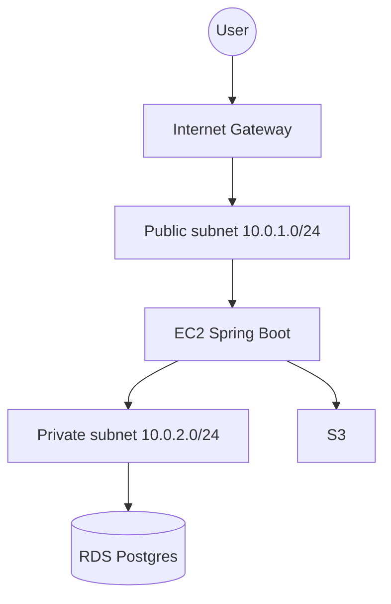

# Mini-project C — VPC Design Sketch (Stretch)

**Topic:** [17 AWS](../../../phase-05-distributed/17-aws.md) · **Phase 5**

---

## Goal

Produce a clear VPC diagram and notes: **public subnet** (EC2) + **private subnet** (RDS) + NAT awareness—even if you do **not** deploy NAT (cost). Learning focus is design literacy, not bill burn.

---

## Prerequisites

- Mini-project A mental model (EC2 + RDS + S3)
- Optional: draw.io / Mermaid / Excalidraw

---

## Learn

| Resource | Why |
|----------|-----|
| [VPC User Guide](https://docs.aws.amazon.com/vpc/latest/userguide/what-is-amazon-vpc.html) | Subnets, route tables |
| [RDS in VPC](https://docs.aws.amazon.com/AmazonRDS/latest/UserGuide/USER_VPC.html) | Private DB patterns |
| NAT Gateway vs instance (cost note) | Outbound from private |

---

## Project layout

```text
vpc-design-sketch/
  docs/
    vpc.mmd                 # Mermaid
    vpc.png                 # optional export
    decisions.md            # CIDR, SG, NAT cost
  README.md
```

---

## Build steps

- [ ] **1. CIDR plan**
  1. Example: VPC `10.0.0.0/16`; public `10.0.1.0/24`; private `10.0.2.0/24`.
  2. **Done when:** CIDRs written in `decisions.md` without overlap mistakes.

- [ ] **2. Mermaid diagram**
  1. Boxes: Internet Gateway, public subnet + EC2, private subnet + RDS, S3 gateway endpoint (optional).
  2. Arrows: user → IGW → EC2; EC2 → RDS; EC2 → S3.
  3. **Done when:** `vpc.mmd` renders and matches the story.

- [ ] **3. Security groups**
  1. Table: SG-App (22 your IP, 8080 your IP); SG-DB (5432 from SG-App only).
  2. **Done when:** Table is in `decisions.md`.

- [ ] **4. NAT awareness**
  1. Explain when private EC2 would need NAT for yum/outbound.
  2. Explicitly state: **not deployed** in this lab to save cost (or deployed with destroy plan).
  3. **Done when:** Cost note is honest.

- [ ] **5. Compare to default VPC lab**
  1. 5 bullets: what Mini-project A likely used vs this sketch.
  2. **Done when:** Comparison written.

- [ ] **6. Optional console walk**
  1. Click through VPC console on default VPC; screenshot subnet map (no new paid NAT).
  2. **Done when:** Screenshot or notes attached.

- [ ] **7. README**
  1. Link diagram + “do not leave NAT Gateway on” warning.
  2. **Done when:** Stretch deliverable is linkable from topic §6.

---

## Definition of Done

- [ ] Diagram: public EC2 + private RDS (+ NAT awareness)
- [ ] SG table
- [ ] Cost/NAT decision documented
- [ ] README complete

---

## Demo



Render Mermaid in GitHub/IDE; walk the diagram aloud in ≤2 minutes.

---

## Common mistakes

| Mistake | Fix |
|--------|-----|
| Deploying NAT “just because” | Sketch first; deploy only with destroy plan |
| RDS in public subnet with 0.0.0.0/0 | Private + SG from app only |
| Diagram without SG story | Always pair diagram + SG table |
| Overlapping CIDRs | Write and check |

---

## After this

- Use this sketch language in Capstone AWS path docs
